<p align="center"></p>

# PropRisk

An open-source risk desk for prop trading firms: write your rules down once as a
versioned rule pack, prove them against your own history before they enforce
anything, and leave behind a decision record you can hand to a disputing trader.

[](./LICENSE)
[](https://github.com/vonzelle-vzt/proprisk/actions/workflows/ci.yml)
[](https://github.com/vonzelle-vzt/proprisk/actions/workflows/security.yml)
[](./risk-management/package.json)

**Who this is for.** A prop firm's own risk and engineering team, running it
for themselves — self-hosted, with no public site in front of it — and anyone
who would rather hand a spec to a coding agent than adopt a black box.
Maintained by VZT Tech Consulting under the MIT licence.

---

<table>
<tr>
<td colspan="2" align="center">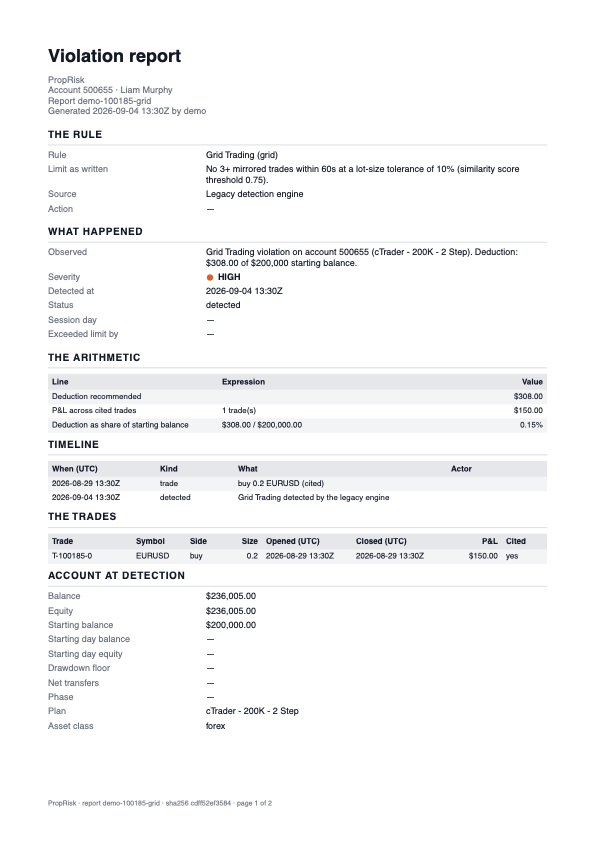<br><sub><b>The deliverable.</b> A generated violation report: the rule as written, what happened, the arithmetic, the timeline, the trades, and the account at detection — over a content hash in the footer. This is the file you hand a disputing trader, and the reason the rest of the product exists.</sub></td>
</tr>
<tr>
<td width="50%">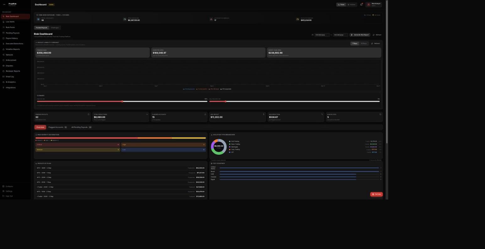<br><sub><b>The risk dashboard</b> — firm-wide exposure across both books, a deterministic payout-liability forecast, severity distribution and the flagged accounts behind it.</sub></td>
<td width="50%">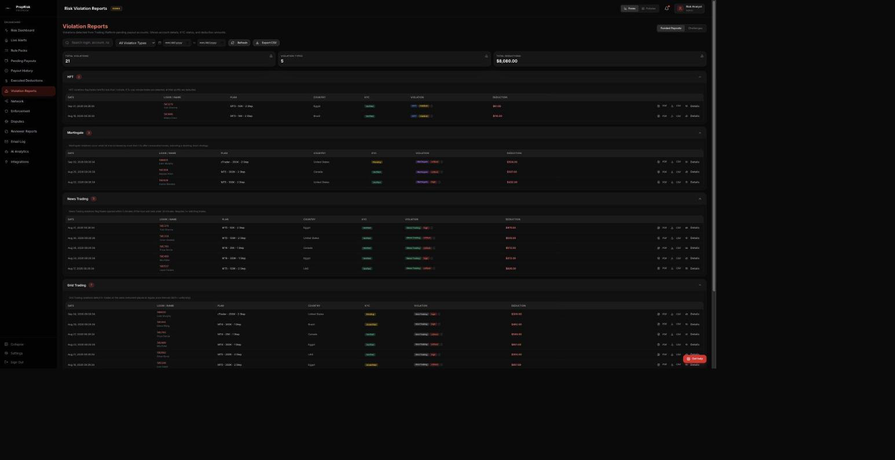<br><sub><b>Violations grouped by rule</b>, each row carrying a PDF and CSV of its own decision record — evidence is one click from the list, not a support ticket.</sub></td>
</tr>
<tr>
<td width="50%">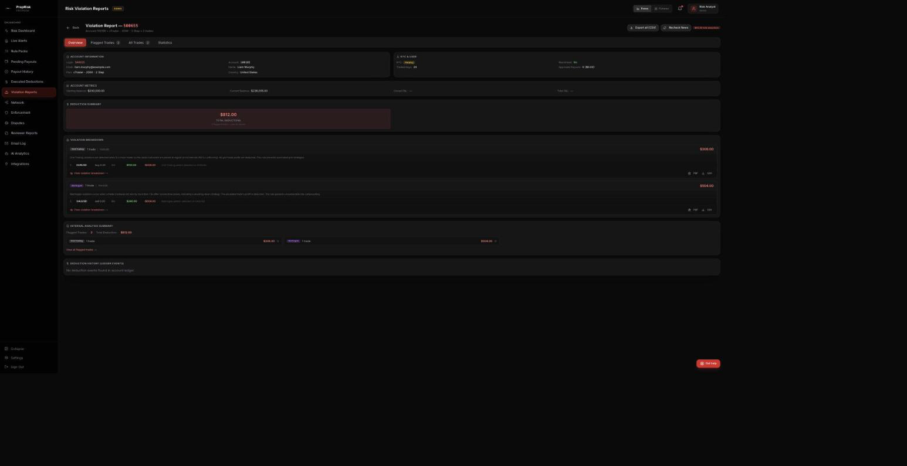<br><sub><b>One account's report</b> — every breach on that account with its trades and arithmetic, an account-wide CSV, and a per-violation PDF on each row.</sub></td>
<td width="50%">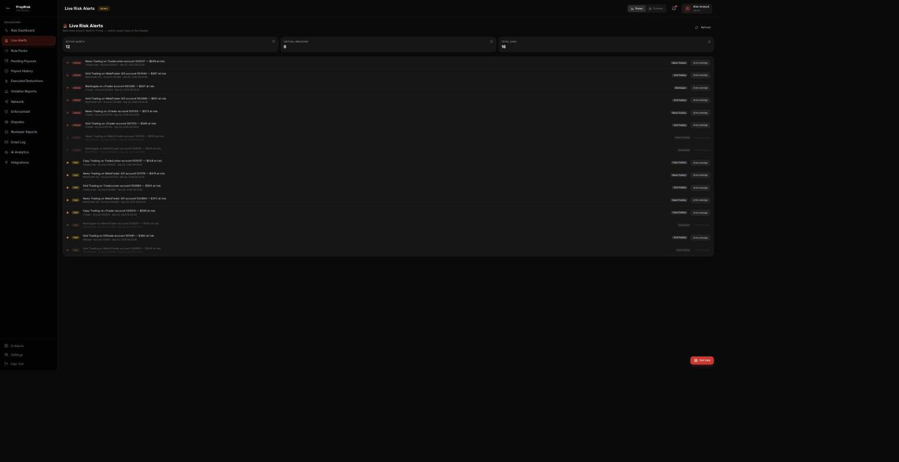<br><sub><b>The live breach feed</b>, refreshed every 30 seconds for whichever book the header toggle has selected — what the desk watches between the morning report and the queue.</sub></td>
</tr>
<tr>
<td width="50%">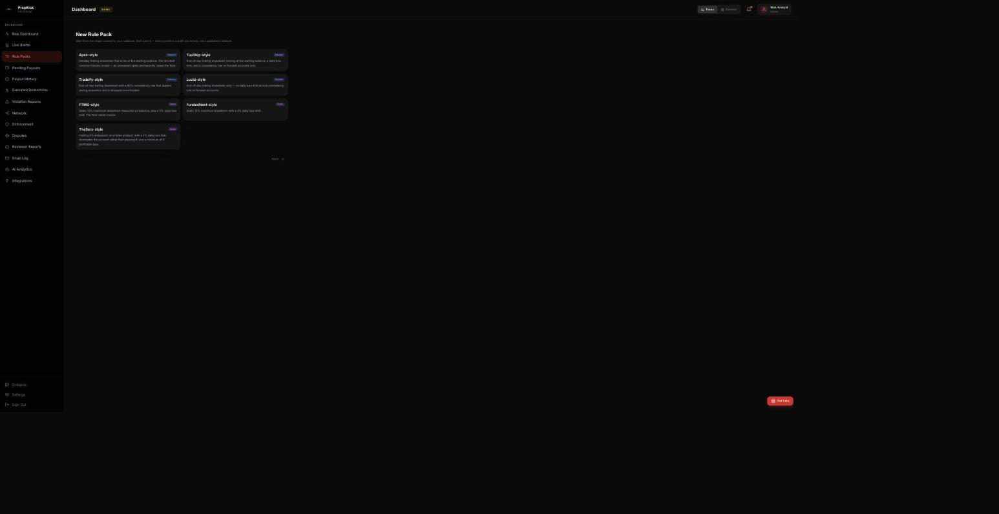<br><sub><b>The preset picker</b> — seven firm-shaped starting points, each described by the rule <i>shape</i> it models, so a firm recognises its own rulebook before it starts typing numbers.</sub></td>
<td width="50%">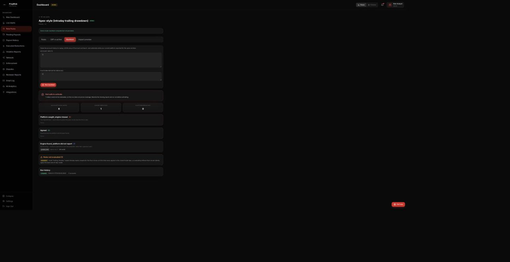<br><sub><b>Shadow-mode backtest</b> — your rules replayed against your own history and reconciled against what your platform reported. This run reads <i>Not safe to activate</i> because one rule could not be evaluated at all.</sub></td>
</tr>
<tr>
<td width="50%">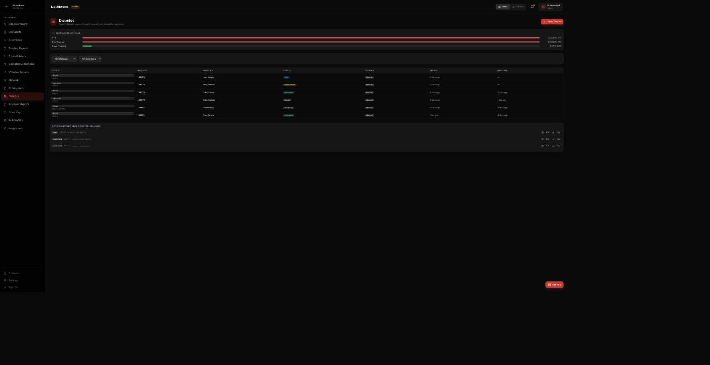<br><sub><b>Disputes</b>, each pinned to the evidence pack as it stood at decision time, under the overturn rate per rule — the number that tells a firm which of its own rules it keeps reversing.</sub></td>
<td width="50%">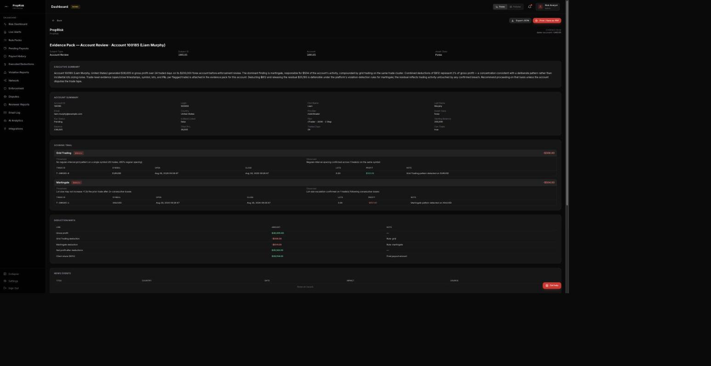<br><sub><b>An evidence pack</b> — account summary, rule-by-rule scoring trail, deduction math and the hash-chained audit entries, exportable as JSON or printed to PDF.</sub></td>
</tr>
<tr>
<td width="50%">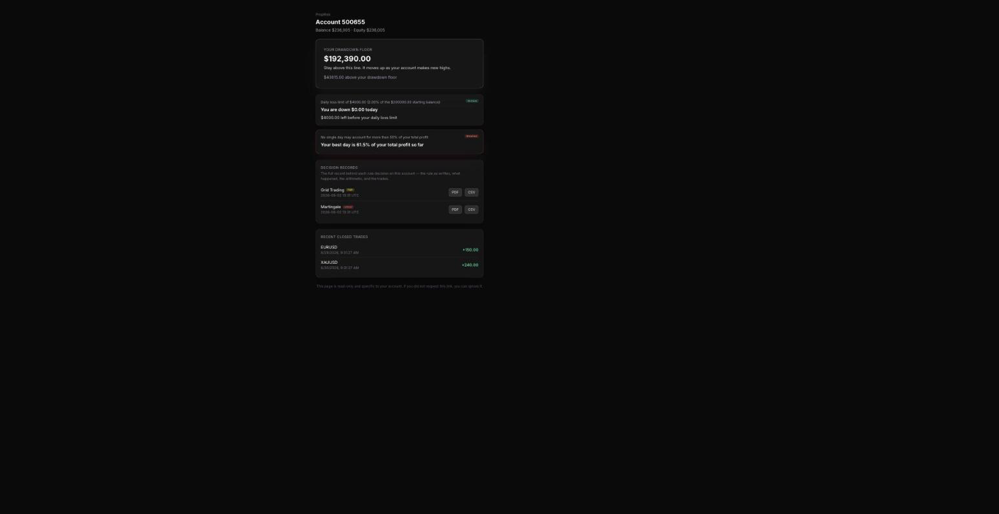<br><sub><b>The trader's own view</b> — where their drawdown floor sits, how much daily loss is left, and their own decision records to download, from a tokenized link with no login.</sub></td>
<td width="50%">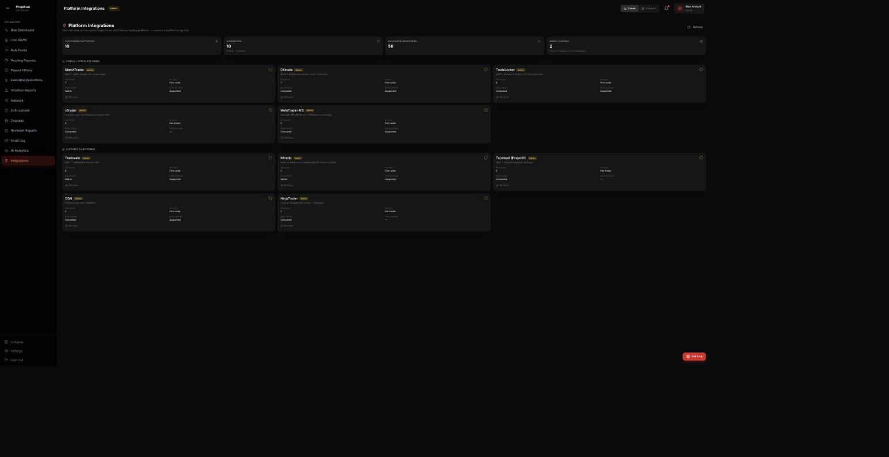<br><sub><b>The integrations board</b> — all ten adapters with transport, access model and whether the platform supports enforcement at all, which decides what this system can and cannot do for you.</sub></td>
</tr>
</table>

Every screenshot is listed in [`docs/screenshots/README.md`](./docs/screenshots/README.md)
and all eleven were captured from demo mode against mock data, so none of them
contains a real firm's data — and you can reproduce any of them in five minutes.

---

## Why this exists

Every prop firm already has risk management. MatchTrader computes drawdown.
Tradovate auto-liquidates. Rithmic has an RMS. A firm does not need a second
system to tell it an account went below a number — its platform already did
that, in real time, better.

What no firm has is a **system of record for risk decisions**: one place where
the rules are written down, applied identically to every account, and where
every breach and every payout decision leaves behind an artifact you can hand to
a disputing trader, a payment processor, or a regulator.

That reframing decides everything else in this codebase:

- The engine is **deterministic and replayable**, because "we cannot reproduce
  why we terminated your account" is the end of a dispute you lose.
- A **human approves every enforcement action**, because a firm's risk team has
  to stay the author of its own decisions — and because an audit trail must be
  able to name someone.
- The **evidence pack is the deliverable**, not a reporting feature bolted on at
  the end.

Firms lose money on disputed breaches, on inconsistent enforcement between
analysts, and on payouts approved by feel. None of those is "we failed to detect
a drawdown". The full argument is in
[`risk-management/docs/HOW-IT-WORKS.md`](./risk-management/docs/HOW-IT-WORKS.md).

## What you get

- **Four flows, end to end** — self-serve onboarding, a monitoring loop, the
  breach flow, and the payout flow. Each is described step by step, with the
  data written at each step, in [`docs/BUILD-SPEC.md`](./docs/BUILD-SPEC.md) §6.
- **Rule packs instead of code** — a closed catalog of 13 parameterised
  primitives and seven firm-shaped presets. Firms differ in parameters, not in
  kind: Apex trails drawdown intraday, TopStep trails it end-of-day and locks it,
  FTMO does not trail at all. That is one primitive with three parameter sets.
  No firm ever supplies code, so nothing tenant-authored is ever executed.
- **Versioned, immutable packs** — a pack that leaves draft can never be edited,
  because editing it would rewrite the rules a past decision was made under.
  Changes fork a new version, and every decision pins the version that produced
  it.
- **A backtest gate before anything enforces** — replay your own last 90 days
  through a candidate pack and reconcile against what your platform actually
  reported. A pack that would have *missed* a breach your platform caught is
  refused activation, because silently relaxing a firm's own rules is the one
  failure mode a risk platform must not have.
- **Five-layer tenant isolation, verified two ways** — described below.
- **An enforcement queue with a human in it** — evidence assembled and a trader
  notice drafted automatically, then approve or reject, singly or in batch,
  with a note. Items nobody touches escalate and expire on a schedule rather
  than sitting there looking decided. The action and the approver's identity
  join a hash-chained audit log.
- **Evidence packs and disputes** — a dispute opens against the evidence pack as
  it existed at decision time, not re-scored months later under whatever rules
  are current, and overturn rate is tracked per rule.
- **A trader-facing view** — a tokenized read-only page showing a trader their
  own account against their own firm's rules, live. Most disputes are surprise
  rather than disagreement, and this is the cheapest way to remove the surprise.
- **Per-violation PDF and CSV reports** — a persisted, deterministic report
  payload rendered on demand at
  `GET /api/violations/[id]/report?format=pdf|csv|json`, an account-wide CSV at
  `GET /api/violations/account/[accountId]/report`, and a trader's own copy
  behind their link. Deterministic because a report a trader disputes must not
  change between two downloads.
- **Optional billing (off by default)** — set `BILLING_ENABLED=true` if you
  want to run this as a hosted service for other firms, and Stripe checkout,
  portal and a signature-verified webhook come online, metered by funded
  accounts monitored. Leave it off and the three `/api/billing/*` routes
  404 and no Stripe env var is ever read — a self-hosted admin console has
  no reason to bill itself.

## Quick start — the demo, in five minutes

Demo mode makes the whole app public and serves coherent mock data from every
API. No database, no trading platform, no keys.

```bash
git clone https://github.com/vonzelle-vzt/proprisk.git
cd proprisk/risk-management
npm install
cp .env.local.example .env.local     # already has NEXT_PUBLIC_DEMO_MODE=true
npm run dev
```

Auth is bypassed, so <http://localhost:3000> lands straight on `/risk`, the
operator console. The whole tour, in order:

1. **`/risk`** — the dashboard. Firm-wide exposure across both books, the
   payout-liability forecast, severity distribution, flagged accounts.
   **Generate Risk Report** produces the morning report on the spot.
2. **`/alerts`** — the live breach feed. The Forex / Futures toggle in the
   header re-scopes this and every other page.
3. **`/violations`** — violations grouped by rule. Press **PDF** on any row:
   `GET /api/violations/100185-grid/report?format=pdf` renders a real,
   two-page report from a real payload, not a placeholder.
4. **`/violations/account/100185`** — every breach on one account, with
   **Export all (CSV)** for the whole account.
5. **`/rules`** — three sample packs: `demo-apex-futures` (active, v2),
   `demo-topstep-futures-draft`, and `demo-ftmo-forex`.
6. **`/rules/demo-apex-futures` → Backtest → Run backtest** — the real engine
   against a synthetic 90-day tape. Six accounts evaluated, one engine breach,
   zero the platform caught and this pack missed, and one rule reported
   `skipped` with the reason it could not be evaluated. The verdict reads
   **Not safe to activate**, which is the entire point of the screen.
7. **`/enforcement`** — the queue: recommendations waiting for a human, scored
   and escalated, none of them acted on until someone approves.
8. **`/disputes`** — cases pinned to evidence, under the overturn rate per rule.
9. **`/evidence/demo-account-100185`** — the dossier behind a decision, with
    **Export JSON** and **Print / Save as PDF**.
10. **`/connections`** — all ten adapters, two of them live.
11. **`/a/demo`** — the trader's own page. Demo mode accepts one fixed token,
    `demo`, and resolves it to mock account 500655: where the drawdown floor
    sits, how much daily loss is left, its consistency position, and a PDF and
    CSV of each decision record. This used to be the one page demo mode could
    not serve; `src/lib/trader/demo.ts` now answers the fixed token from the
    mock dataset without touching a database.

Demo mode is a single chokepoint (`src/lib/demo/`), not a fork of the code: the
admin database client and the provider facade both throw while it is on, so the
demo cannot write anywhere even by accident.

## Install

Three ways in, all documented step by step in [`docs/INSTALL.md`](./docs/INSTALL.md):

```bash
# 1. One line: clone into ./proprisk and set up the demo
curl -fsSL https://raw.githubusercontent.com/vonzelle-vzt/proprisk/main/scripts/install.sh | bash

# 2. Manual: clone, then let the setup script check Node, install, and write .env.local
git clone https://github.com/vonzelle-vzt/proprisk.git && cd proprisk
bash scripts/setup.sh --demo        # or --live to generate secrets for a real deployment

# 3. Docker: build and run the demo image
docker compose up proprisk-demo     # http://localhost:3000
```

`scripts/setup.sh --live --db-url <postgres url>` also applies the migrations in
order and generates `CRON_SECRET`, `PLATFORM_ADMIN_SECRET` and
`CONNECTIONS_MASTER_KEY` for you. The install guide covers local development
against a Supabase CLI stack, production on Vercel, self-hosting with Docker and
an external scheduler, the post-install checklist, upgrades and troubleshooting.

## Run it for real

1. **Create a Supabase project.** Postgres plus auth; nothing else is required.
2. **Apply the migrations in order** from `risk-management/supabase/migrations/`
   — `00001` is the consolidated baseline schema, tenancy and row-level security
   arrive in `00015`, and every file after that only appends.
3. **Set the environment.** `NEXT_PUBLIC_SUPABASE_URL`,
   `NEXT_PUBLIC_SUPABASE_ANON_KEY`, `SUPABASE_SERVICE_ROLE_KEY`, `CRON_SECRET`,
   `PLATFORM_ADMIN_SECRET`, `CONNECTIONS_MASTER_KEY`, `NEXT_PUBLIC_APP_URL`, and
   `NEXT_PUBLIC_DEMO_MODE=false`. Every variable is annotated in
   [`.env.local.example`](./risk-management/.env.local.example).
4. **Create your first tenant** at `/signup`. That form creates the firm and its
   owner; there is no seeding step and no per-firm deployment.
5. **Connect your trading platform.** `POST /api/connections` stores the
   credentials envelope-encrypted per tenant, and
   `POST /api/connections/[provider]/validate` proves they can actually read
   your accounts — a thing to discover during onboarding rather than at 3am.
   `/connections` is the read-only status board for all ten adapters; the
   credential form itself is not in the UI yet.
6. **Pick a preset** at `/rules/new` and tune it to your own rulebook, then
   save it as a draft.
7. **Promote it to testing and backtest it.** Read the reconciliation.
8. **Activate.** Activation is refused while the backtest shows a breach your
   platform caught and this pack missed.

Full instructions, including deployment without Vercel, secret rotation and
backups: [`docs/SELF-HOSTING.md`](./docs/SELF-HOSTING.md).

## Using it day to day

Once a pack is active, the product is a routine rather than a tool, and
[`docs/USAGE.md`](./docs/USAGE.md) is that routine written out screen by
screen — what each page is for, what every button writes, and the demo path to
try it on before it is your own book.

The shape of an operator's day:

- **Morning.** `/risk` → **Generate Risk Report**: pending payouts and their
  total, accounts flagged, deductions, security flags, top risk accounts. The
  `morning-report` cron writes the same thing to `morning_reports` at 12:00 UTC.
- **Through the day.** `/alerts` is the feed; the Forex / Futures toggle
  re-scopes it and every other page, because one desk usually watches both
  books and the rules are not the same on each.
- **When something breaches.** `/violations` → the account → the evidence pack
  → `/enforcement`, where a human approves or rejects and the action joins a
  hash-chained audit entry naming them. Nothing reaches a trader's account
  until someone does.
- **Payouts.** Expand a request on `/payouts` for the deterministic rationale,
  run the risk check and the IP check, pre-approve, then approve or reject. The
  provider call happens before anything is persisted, so a failed platform call
  cannot leave a row claiming a payout that never happened.
- **When a trader argues.** Send the per-violation PDF from `/violations`, or
  their own tokenized link — it renders from a persisted, content-hashed
  payload, so two downloads a month apart are the same document. If they
  escalate, open a case at `/disputes`, which pins the evidence pack as it stood
  at decision time rather than re-scoring under today's rules.
- **After any schema change.** Run both isolation checks. They answer different
  questions, and only one of them runs in CI.

## Tailor it to your firm

A rule pack is JSON. This is roughly half of the TopStep-style preset, and the
comments are the parts people get wrong:

```jsonc
{
  "schema_version": 1,
  "asset_class": "futures",
  "name": "House Rules",
  "session": {
    "timezone": "America/New_York",
    "day_start": "17:00",          // the CME session for Monday opens 17:00 ET Sunday
    "week_start": "sunday"
  },
  "rules": {
    "drawdown": {
      "enabled": true,
      "mode": "trailing_eod",      // static | trailing_intraday | trailing_eod
      "lock": "at_initial_balance",// where a trailing floor stops trailing
      "basis": "equity",
      "threshold": { "type": "pct_of_initial", "value": 0.04 },  // 0.04 = 4%, a fraction
      "applies_to_phases": ["challenge", "verification", "funded"],
      "action": "terminate"        // independent of the threshold
    },
    "consistency": {
      "enabled": true,
      "max_best_day_pct_of_profit": 0.5,
      "evaluated_at": "payout",
      "min_profit_to_evaluate": 0,
      "applies_to_phases": ["funded"]   // this rule exists only once funded
    }
    // A rule you omit does not exist. That is not the same as a generous
    // threshold: some firms genuinely have no daily loss limit, and modelling
    // that as a very large number produces breaches that never happened.
  }
}
```

[`docs/TAILORING.md`](./docs/TAILORING.md) maps every common prop-firm rule onto
a primitive and its parameters, and covers branding, connecting your platform,
finishing a stub adapter, the staged-launch gate, trader links and reports.

## Rebuild it with an agent

[`docs/BUILD-SPEC.md`](./docs/BUILD-SPEC.md) is written so that an agent with no
access to this repository could build an equivalent system, and so that an agent
that does have the repository can check itself against the reference
implementation at every step. It contains the invariants, the data model, the
rule-pack contract, the provider contract, the four flows, and thirteen
milestones — each with deliverables and a **verification command whose expected
output is stated**, so "done" is something a machine decides.

Two prompts are ready to paste:

- [`docs/agent-prompts/rebuild-from-scratch.md`](./docs/agent-prompts/rebuild-from-scratch.md)
  — build the whole system, milestone by milestone, oracle by oracle.
- [`docs/agent-prompts/tailor-to-my-firm.md`](./docs/agent-prompts/tailor-to-my-firm.md)
  — fill in your firm's name, rulebook URL and platform; the agent writes the
  pack, brands the app, connects the platform, runs the backtest and reports the
  reconciliation.

Any agent that can read a file and run a shell command will do — Claude Code,
Codex, Cursor, or something you wrote yourself. Nothing in the spec depends on a
particular tool.

## Architecture

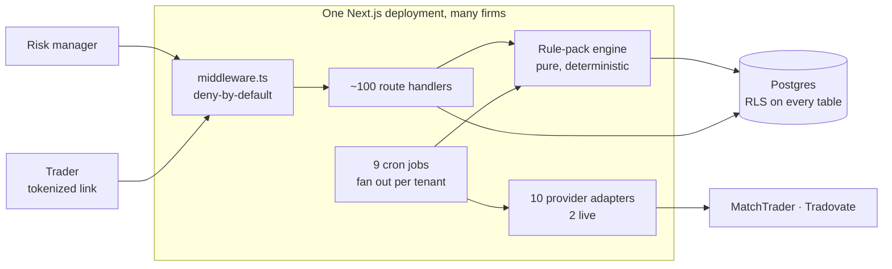

Three fuller diagrams — system context, the request path with each isolation
layer marked, and the breach flow as a sequence — are in
[`docs/architecture.md`](./docs/architecture.md).

**Stack.** Next.js 14 App Router, TypeScript in strict mode, Tailwind 3.4,
Supabase (Postgres and auth), Recharts, vitest. Optional: Upstash Redis for rate
limiting and per-tenant queue namespaces, Stripe for billing, Resend or Gmail
for outbound mail. Node 20 or newer. Deployable to Vercel — the nine cron
schedules live in `risk-management/vercel.json` — or to any Node host with an
external scheduler.

## Frequently asked

**Is there a public website or pricing page?** No — this is an admin console.
Signed-out visitors see the login screen, not a pitch. Billing is optional and
off by default; see `BILLING_ENABLED` in [`docs/TAILORING.md`](./docs/TAILORING.md)
if you want to run it as a hosted service for other firms.

**Is this a trading platform?** No. It never sees an order, a chart or a price
feed, and it will not make your traders faster. It reads what your platform
already recorded and turns each risk decision into something you can defend.

**Does it execute trades or move money?** It does not trade. It can ask your
platform to restrict, suspend or flatten an account, and it can execute a
deduction — but only after a human approves the item in `/enforcement`, and
only through the owning adapter. The provider call happens before anything is
persisted, so a failed platform call never leaves a row claiming an action that
did not happen.

**Can my traders see it?** Only their own account, and only if you hand them a
link. `POST /api/accounts/[login]/trader-link` mints a tokenized URL that
carries no session and resolves to exactly one (tenant, account) pair; the
token's sha256 hash is all that is stored, it expires in 30 days by default,
and `DELETE` on the same route revokes it. Try it at `/a/demo`.

**What if my platform is not one of the two live adapters?** Then you finish a
stub. All ten are registered with their real auth, transport and access model,
and a stub throws rather than returning an empty list — because an empty list
reads as "no breaches". [`docs/TAILORING.md`](./docs/TAILORING.md) says what
"finished" means and how to prove it.

**Why are the presets shipped unverified?** Because saying so is cheaper than
being wrong quietly. They were built from secondary research rather than the
firms' published terms, so every threshold is a claim you should check against
your own rulebook — and the backtest is there to show you where a preset
disagrees with the platform you already run.

**Can I run this without Vercel?** Yes. It is an ordinary Node app; the only
Vercel-specific file is `risk-management/vercel.json`, which holds the nine
cron schedules. Point any external scheduler at the same `/api/cron/*` paths
with `Authorization: Bearer $CRON_SECRET` — there is a ready-made crontab in
[`docs/SELF-HOSTING.md`](./docs/SELF-HOSTING.md) §5.

**How do I remove the PropRisk branding?** Environment variables. Product name,
company line, tagline, logo, favicon, the accent and neutral colours, and the
outbound sender all come from `risk-management/src/config/brand.ts`, which
reads each from the environment and falls back to a default so the demo still
renders. Nothing about the brand is compiled in; see
[`docs/TAILORING.md`](./docs/TAILORING.md) §3.

**If I run one instance for several firms, is their data actually separated?**
Yes, and you do not have to take that on faith. Isolation is enforced in five
places rather than one, and two machine checks answer the two different
questions — `verify-isolation.sh` builds a real Postgres and tries to break out
of a tenant; `check-isolation.mjs` fails the build on the four edits that
historically erode it, and runs in CI. Both are in the next section.

## Honest current state

This section is part of the project rather than a disclaimer under it. Read it
before you build on this.

- **The multi-tenant build has not yet run in production.** An earlier
  single-tenant version of this engine ran against live funded accounts at a
  firm we do not name; the tenancy layer, the rule-pack engine and the reports
  in this repository are newer, and are verified — a green test suite, a
  machine-checked isolation suite, deterministic golden vectors — but verified
  is not the same as proven in production.
- **Only 2 of 10 provider adapters are live**: MatchTrader (forex) and Tradovate
  (futures), both written against published API specifications. The other eight
  are documented stubs that describe their real auth and transport but do not
  call it. Treat the list of ten as a roadmap, not an inventory.
- **The seven presets are unverified drafts.** They were built from secondary
  research, not from the firms' published terms. Each carries a source URL and a
  `verifiedAt` that is `null`, and `presetConfidence()` in
  `risk-management/src/lib/rulepack/presets.ts` calls a preset `stale` 90 days
  after it was last checked — though neither the confidence nor its
  customer-facing notice is surfaced in the picker yet, so today the honest
  warning is this paragraph rather than a badge in the product. A stale preset
  applied as-is breaches accounts against rules nobody agreed to, which is worse
  than shipping no preset, because it carries false authority. Check every
  threshold against your own rulebook, and let the backtest tell you where it
  disagrees.
- **Intraday-trailing drawdown needs snapshot ingestion to be fully evaluable.**
  The peak the floor follows can occur while a position is open and never appear
  in the closed-trade tape. The engine is honest about this — it reports the
  rule as `skipped` with a reason rather than quietly applying the more
  forgiving end-of-day model — but "we could not evaluate your main rule" is a
  gap, not a feature. Push equity samples to
  `POST /api/ingest/equity-snapshots` or enable the polling cron.
- **The failure mode to watch for is not a crash.** It is a job that reports
  success while doing nothing. Every background job here reports what it
  persisted rather than what it attempted, and a rule that could not be
  evaluated is reported `skipped` — never folded into "no breach".
- **The dependency audit is not empty.** CI and the security workflow both pass
  and Dependabot is on, but the security job gates on *critical* findings only;
  the remaining high findings come from the pinned Next.js version, and
  [issue #1](https://github.com/vonzelle-vzt/proprisk/issues/1) tracks the
  Next 16 upgrade that clears them.

## Security

Tenant isolation is a product promise, so it is enforced five times over and
checked by machine: the tenant claim lives in Supabase `app_metadata` (never
user-editable `user_metadata`); row-level security with `WITH CHECK` on every
write; request-scoped database access so route handlers stay inside RLS; a
scoped data-access layer that cannot build a query without naming a tenant; and
runtime partitioning of credential keys, provider token caches, Redis namespaces
and cross-account scans. The reasoning for each layer is in
[`risk-management/docs/ISOLATION.md`](./risk-management/docs/ISOLATION.md).

Two checks answer different questions, and both should run:

```bash
# Does isolation hold? Builds a real Postgres 17 on port 55432 and tries to
# read, write and delete across the tenant boundary.
bash risk-management/supabase/tests/verify-isolation.sh

# Will it still hold tomorrow? Fails the build on the four edits that
# historically erode it. This one runs in CI.
node risk-management/scripts/check-isolation.mjs
```

Provider credentials are envelope-encrypted: one master key in the environment,
never in the database, and a per-tenant AES-256-GCM key derived from it by HKDF
salted on the tenant id — so a leaked row is useless without the master key, and
one tenant's key cannot decrypt another's blob.

To report a vulnerability, see [`SECURITY.md`](./SECURITY.md). Please do not
open a public issue for one.

## Contributing

Read [`CONTRIBUTING.md`](./CONTRIBUTING.md) and
[`CODE_OF_CONDUCT.md`](./CODE_OF_CONDUCT.md). The two contributions that help
most:

- **A verified preset.** Check a preset against the firm's current published
  terms, set `verifiedAt` and `verifiedBy`, and cite the page you read.
- **A finished provider adapter.** Eight stubs already document their auth and
  transport; `docs/TAILORING.md` explains what "finished" means and how to prove
  it.

Before opening a pull request:

```bash
cd risk-management && npm run lint && npm run typecheck && npm test && npm run check:isolation
node ../scripts/release/check-doc-links.mjs
```

## License

MIT. See [`LICENSE`](./LICENSE).
