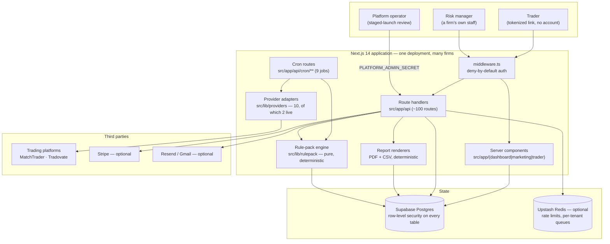
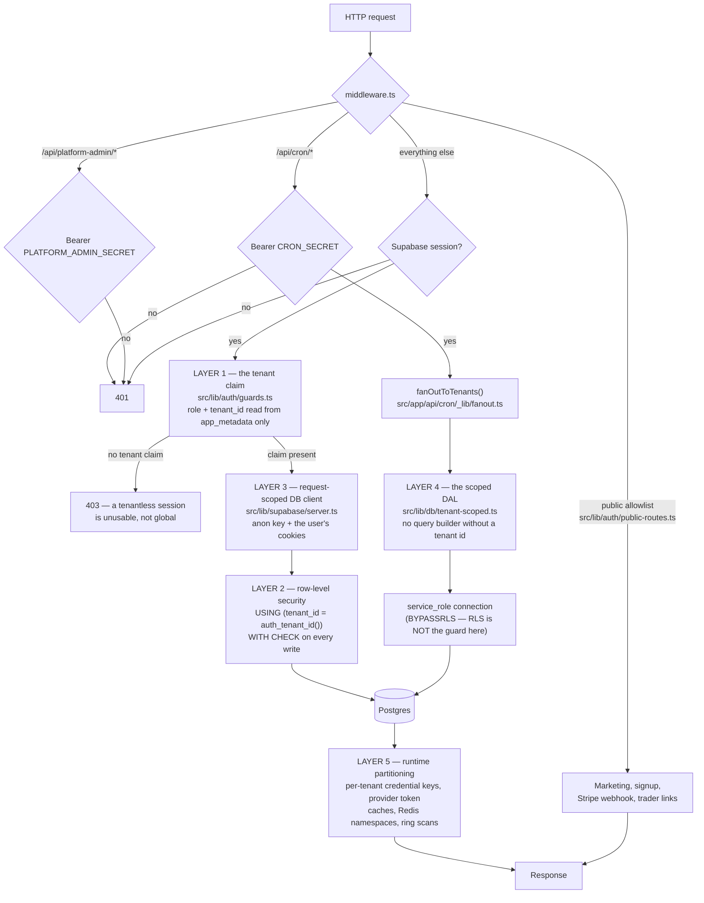
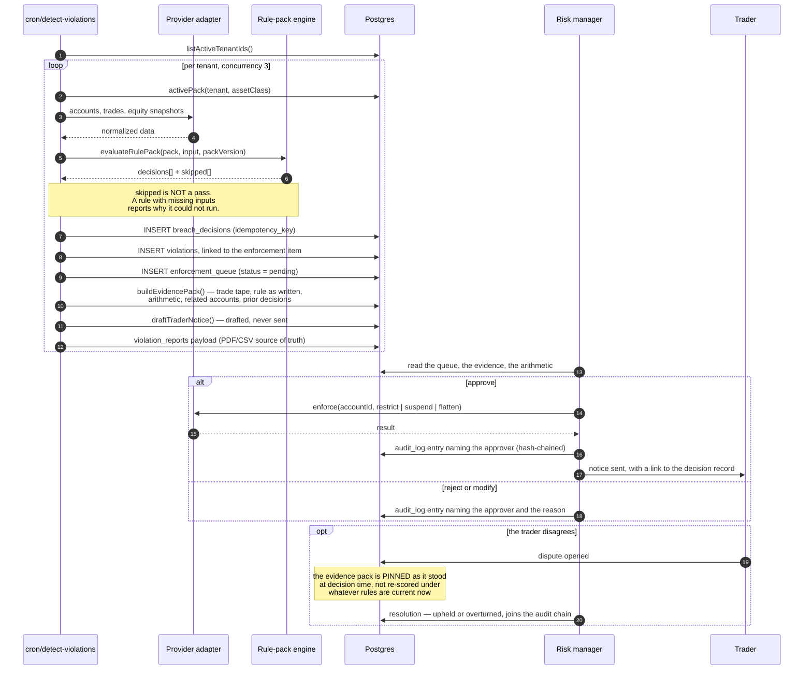

# Architecture

Three diagrams: what the system is made of, what happens to a single request,
and what happens to a single breach. Everything below describes code that is in
this repository — file paths are given so a diagram can be checked against the
thing it claims to describe.

For the reasoning behind these shapes, read
[`risk-management/docs/HOW-IT-WORKS.md`](../risk-management/docs/HOW-IT-WORKS.md).
For the isolation model, read
[`risk-management/docs/ISOLATION.md`](../risk-management/docs/ISOLATION.md).

---

## 1. System context

One deployment serves every firm. A firm's data is separated inside the
database rather than by giving each firm its own database, which is what makes
self-serve signup possible at all — a per-firm deployment cannot be created by
someone filling in a form.

Notes worth reading off the diagram:

- **The engine has no I/O.** `src/lib/rulepack/evaluate.ts` is a pure function
  from (pack, inputs) to decisions. Everything that talks to the world is
  outside it, which is why a backtest can be the identical call.
- **Traders never get a session.** The token in their URL is verified
  server-side on every request (`src/lib/trader/tokens.ts`) and resolves to
  exactly one (tenant, account) pair.
- **The platform operator is not a customer role.** Staged-launch review is
  gated on a separate shared secret in `middleware.ts`, so no tenant session —
  including a compromised owner account — can reach it.

---

## 2. Request path, and where isolation is enforced

The five layers are not five checks in one place; they are five different
mechanisms that would each have to fail. This diagram shows where each sits on
the path of a single request.

Two facts this diagram is drawn to make obvious:

- **Route handlers and background jobs are protected by different layers.** A
  route is constrained by RLS because it connects as the signed-in user. A cron
  has no session, must use the service role, and is therefore constrained only
  by the scoped data-access layer. Confusing the two is how a leak gets written.
- **`auth_tenant_id()` returns NULL when the claim is absent**, and
  `tenant_id = NULL` is NULL rather than TRUE, so every policy fails closed. A
  token with no tenant claim sees nothing at all.

`node risk-management/scripts/check-isolation.mjs` fails the build on the four
edits that historically erode this; `risk-management/supabase/tests/verify-isolation.sh`
builds a real Postgres and tries to break out of it.

---

## 3. The breach flow

From an ingested trade to an enforced action. The human step in the middle is
the product, not a stage that automation has not reached yet.

The ordering in the payout flow is the mirror image and matters just as much:
the provider call happens **before** persistence, so a failed platform call can
never leave a decision row claiming a payout that did not happen.
